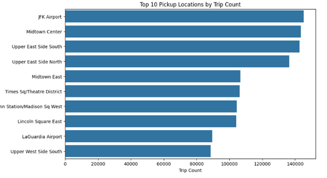
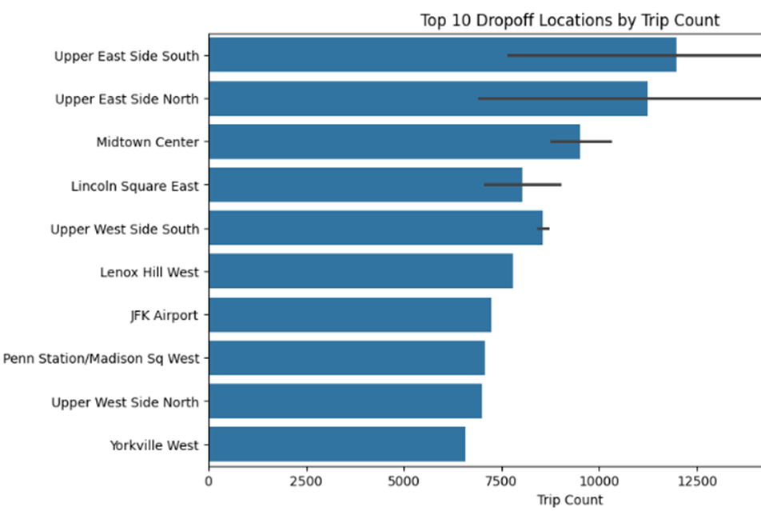
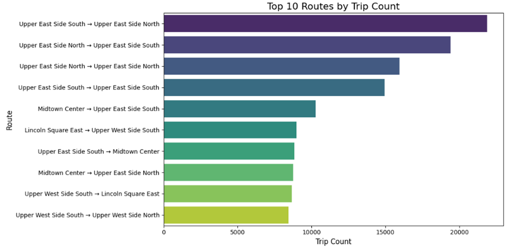
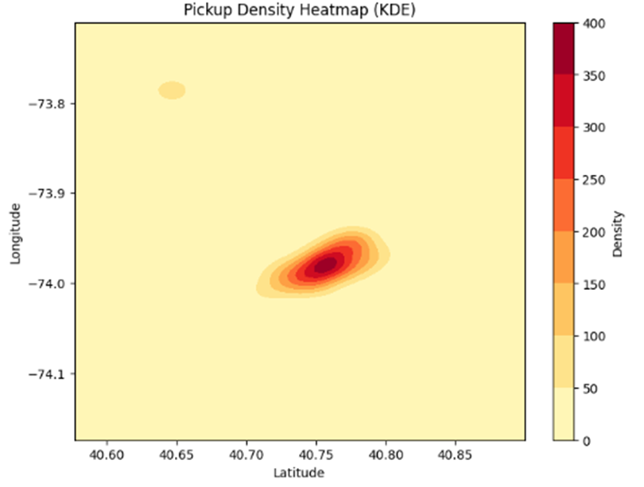
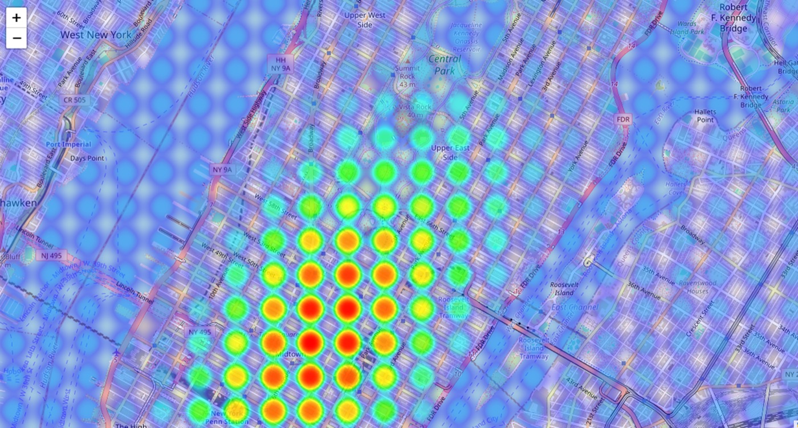
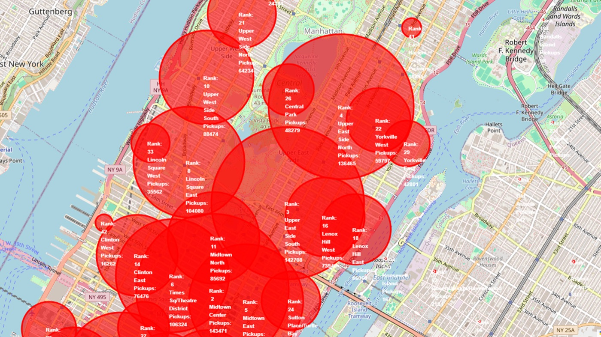
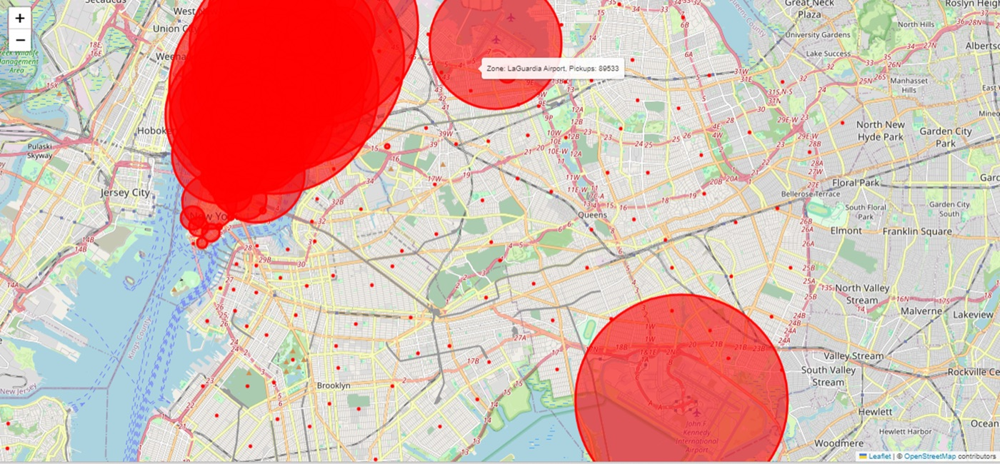

# NYC Yellow Taxi Demand Analysis (January 2024)

When, where and how New Yorkers take yellow cabs: exploratory and statistical analysis of about 3 million taxi trips.

Final project for **DSE 501: Statistics for Data Analysts, Arizona State University (Fall 2024)**.
Team: Aman Gupta, Isan Agrawal, Sruthi Keerthana Nuttakki, Sushma Niresh.

## My contribution: geographic demand and hotspot analysis
I led the spatial part of the project: where taxi demand is concentrated and where service is missing.
- **Top zones:** ranked the most frequent pickup and drop-off zones across all five boroughs.
  - Top pickup zones: JFK Airport and Midtown Center.
  - Top drop-off zones: Upper East Side North and South, and Midtown Center.
- **High-frequency routes:** found the busiest origin–destination pairs. Short trips within the Upper East Side (North ↔ South) are among the most common.
- **Kernel density heatmap:** smoothed pickup density across NYC. It shows dense demand in Midtown Manhattan and at JFK, and sparse demand on Staten Island and in parts of the Bronx.
- **Interactive map:** a zoomable density map for exploring demand down to block level.
- **Hotspot detection:** flagged zones where pickups far exceed the average. The top hotspots are JFK Airport, Midtown Center and Upper East Side North.
- **Recommendations:** more cabs in the high-demand zones at peak times, and targeted coverage for underserved areas.

### Figures

**Top pickup zones:** JFK Airport leads, with Midtown Center (143,471 pickups) and Upper East Side South (142,708) close behind.


**Top drop-off zones:**


**Busiest routes:** trips within the Upper East Side dominate. Upper East Side South → North has about 22,000 trips.


**Pickup density (kernel density estimate):** demand is concentrated in Midtown Manhattan, with a smaller cluster at LaGuardia.


**Interactive heatmap (Folium/Leaflet), zoomed to Midtown:**


**Hotspot map:** circles are sized by pickup volume and labeled with rank and count.
- Manhattan: Midtown Center (#2, 143,471), Upper East Side South (#3, 142,708), Upper East Side North (#4, 136,465), Times Square/Theatre District (#6, 106,324), Lincoln Square East (#8, 104,080).


- Citywide, the airports stand out: JFK, and LaGuardia with 89,533 pickups. Most of Brooklyn and Queens shows very little yellow-cab demand.


*The map and heatmap code isn't in this repo yet. The figures are from the project report.*

## Data
[NYC TLC Trip Record Data](https://www.nyc.gov/site/tlc/about/tlc-trip-record-data.page): Yellow Taxi, January 2024.
- **2,964,624 trips × 19 columns** (Parquet)
- Columns include pickup and drop-off times and zones, trip distance, fares, tips, payment type and passenger count

The data file is not included. Download `yellow_tripdata_2024-01.parquet` from the TLC site into the repo folder.

## Notebooks
| Notebook | What's in it |
|---|---|
| `notebooks/01_eda_cleaning_distributions.ipynb` | Cleaning (datetime parsing, trip duration, removing zero or negative distance and duration), time features (pickup day and hour), distributions of passengers, distance, duration, fare, payment type, rate code and congestion surcharge, correlation heatmap, pickup/drop-off density |
| `notebooks/02_demand_fares_trip_duration.ipynb` | Duplicates and negative-fare checks, demand by hour, top pickup zones, fare versus distance and revenue, trip duration by hour of day (traffic effect) |

## Key findings (team report)
- **Trips:** the average trip is about 3.65 miles. Most rides have 1 passenger and are paid by credit card.
- **Fares:** trip distance and fare are strongly correlated (r = 0.89); tip and fare moderately (r = 0.45).
- **Hotspots:** JFK Airport, Midtown Center and Upper East Side North have the most pickups. Staten Island and parts of the Bronx are underserved.
- **Timing:** demand peaks in mid-afternoon (around 3 PM). Tuesday and Friday are the busiest weekdays.
- **ANOVA:**
  - Day of the week significantly affects passenger count (one-way, F = 1915.16, p < 0.001).
  - A two-way ANOVA found significant effects of hour (F = 263.57), day (F = 1525.01) and their interaction (F = 16.14).

## Why it matters
These results can guide where fleets position cabs and how drivers plan shifts: more cabs at JFK and Midtown at peak times, and targeted coverage for underserved boroughs.

## Run it
```bash
pip install -r requirements.txt
jupyter notebook notebooks/
```
